<!--
  ┌───────────────────────────────────────────────────────────┐
  │  Mau tambah sosial media nanti? Hapus tanda komentar di    │
  │  blok "SOCIALS" di bawah dan isi username/link kamu.        │
  └───────────────────────────────────────────────────────────┘
-->

<div align="center">


[](https://github.com/EkoPrasetyoAdiNugroho)


[](https://github.com/EkoPrasetyoAdiNugroho?tab=followers)


<!-- ===== SOCIALS (buka komentar & isi nanti) =====
[](mailto:EMAIL_KAMU@gmail.com)
[](https://www.linkedin.com/in/USERNAME_KAMU)
[](https://instagram.com/USERNAME_KAMU)
================================================= -->

</div>

## <samp>&#9654; START MENU — whoami</samp>

<table>
<tr>
<td valign="top" width="52%">

```
╔═ PLAYER CARD ══════════════════════╗
  NAME    Eko Prasetyo Adi Nugroho
  CLASS   Web Developer
  GUILD   Unismuh Makassar
  REGION  Makassar, Indonesia
  FOCUS   Web · Automation · AI
  STATUS  building & shipping  ▸
╚════════════════════════════════════╝
```

</td>
<td valign="top" width="48%">

```ts
const eko = {
  role: "Web Developer",
  stack: ["React", "TypeScript", "Node"],
  loves: ["automation", "AI tooling", "3D"],
  motto: "build . break . automate",
  coffee: Infinity,
};
// ▸ permanently in build mode
```

</td>
</tr>
</table>

## <samp>&#9654; LOADOUT — tech_stack</samp>

<div align="center">

**Frontend**

[](https://skillicons.dev)

**Backend &amp; Data**

[](https://skillicons.dev)

**Tools &amp; AI**

[](https://skillicons.dev)

</div>

## <samp>&#9654; QUEST LOG — projects</samp>

| 🎮 Quest | 📜 Mission Log | 🧰 Arsenal |
|---|---|---|
| [🛡️ SMK Zero-Trust Blockchain](https://github.com/EkoPrasetyoAdiNugroho/smk-zero-trust-blockchain-security) | Sistem akademik Zero Trust + EduChain blockchain untuk verifikasi ijazah anti-palsu | `TypeScript` · `Blockchain` · `KMS` |
| [🧠 Tanya Pakar](https://github.com/EkoPrasetyoAdiNugroho/Tanya-Pakar) | Sistem pakar diagnosa (manusia, hewan, hardware) — Forward Chaining + Certainty Factor | `MERN` · `AI` |
| [📣 SI-ADU — Web Pelaporan](https://github.com/EkoPrasetyoAdiNugroho/Web-Pelaporan) | Layanan aspirasi &amp; pengaduan kampus + AI Assistant &amp; real-time tracking | `TypeScript` · `AI` |
| [📖 Kamus Bahasa Makassar](https://github.com/EkoPrasetyoAdiNugroho/Kamus-Bahasa-Makassar) | Kamus web dengan pencarian algoritma Naive String Matching &amp; KMP | `JavaScript` · `Algorithms` |
| [🎲 Ludo Game](https://github.com/EkoPrasetyoAdiNugroho/LUDO-GAME) | Board game Ludo klasik yang bisa dimainkan langsung di browser | `TypeScript` · `Game` |
| [🛏️ Simulasi Kamar Tidur 3D](https://github.com/EkoPrasetyoAdiNugroho/Simulasi-Kamar-Tidur-3D) | Simulasi ruangan 3D interaktif di web | `TypeScript` · `Three.js` |

## <samp>&#9654; HIGH SCORES — stats</samp>

<div align="center">



</div>

## <samp>&#9654; MINI-GAME — snake.exe</samp>

<div align="center">



<br/><br/>


</div>
